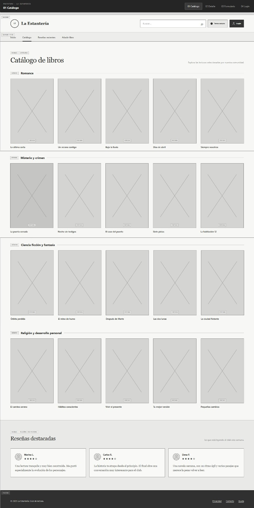
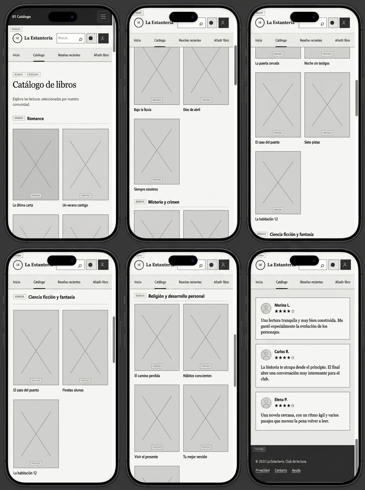
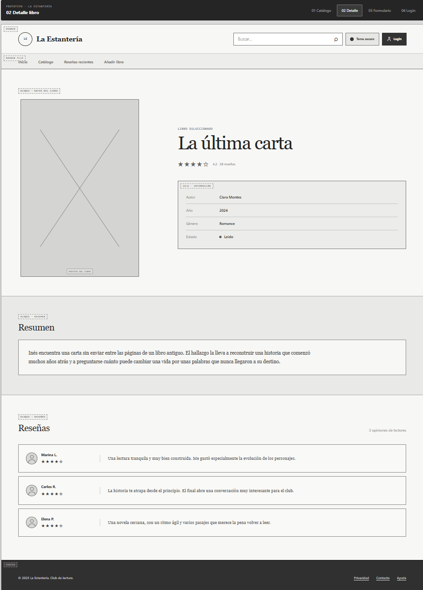
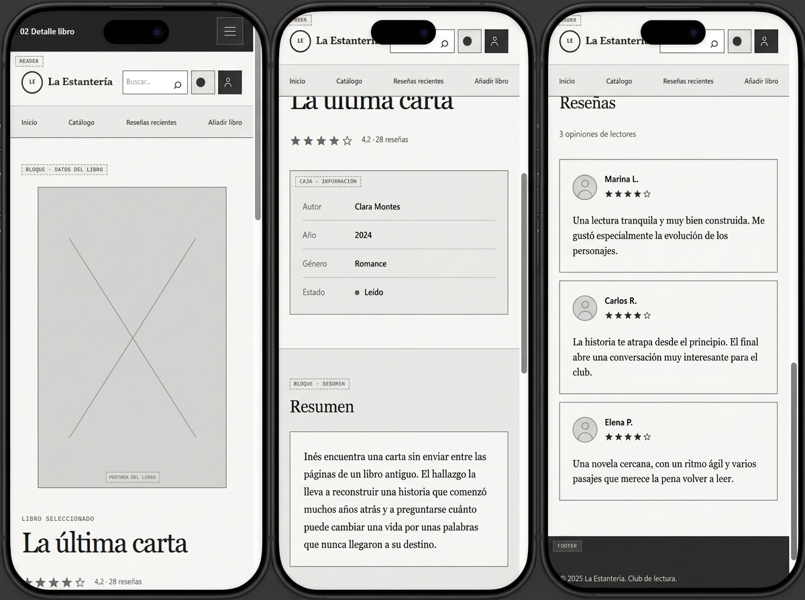
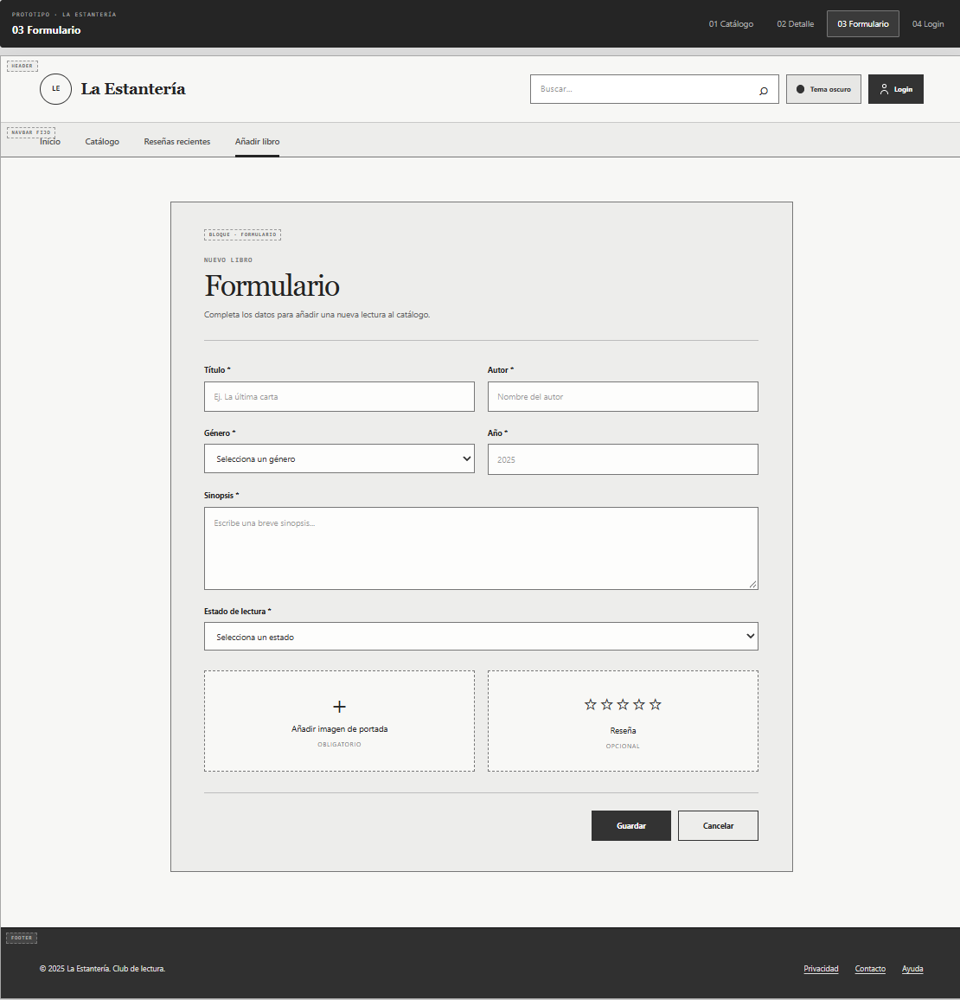
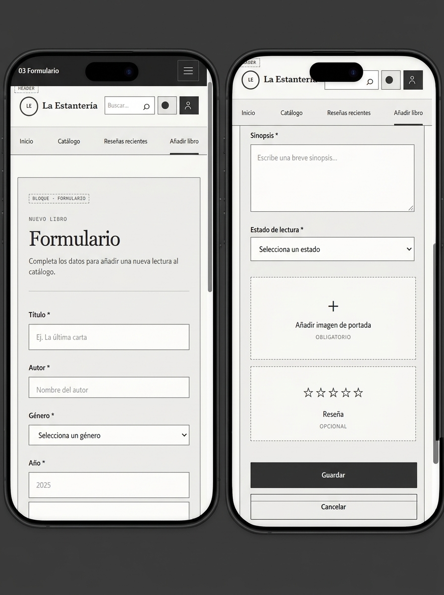
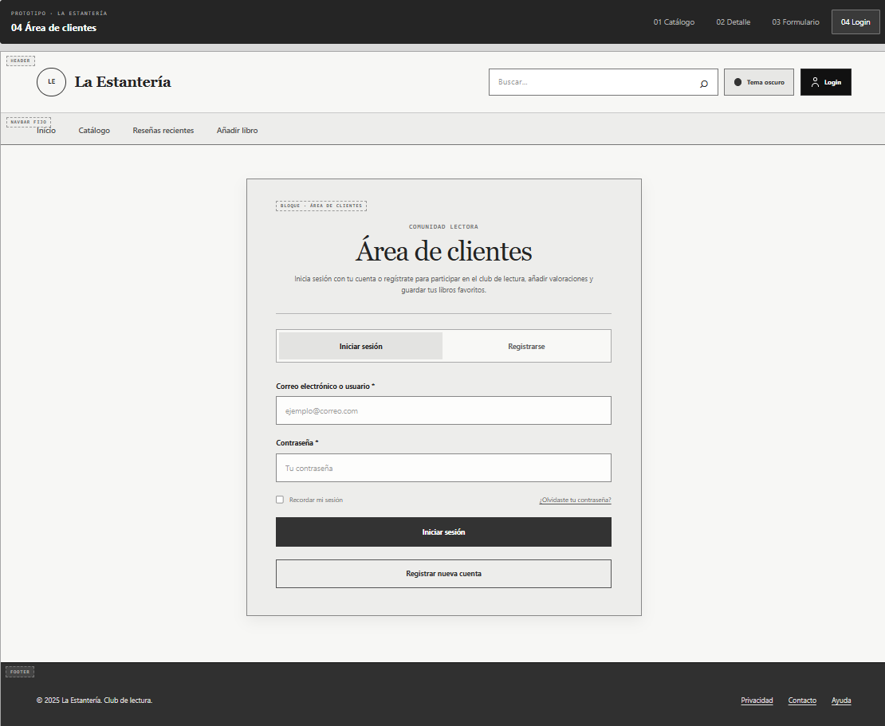
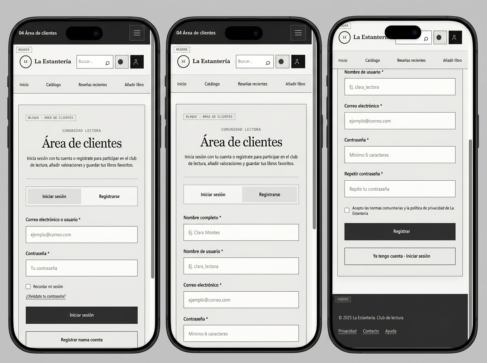
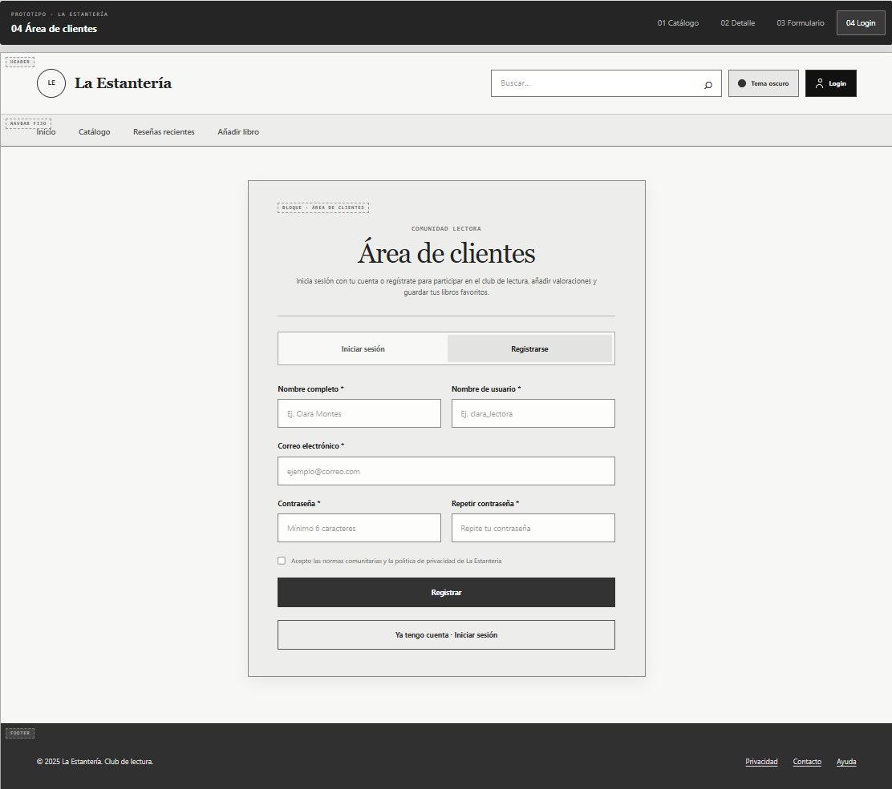
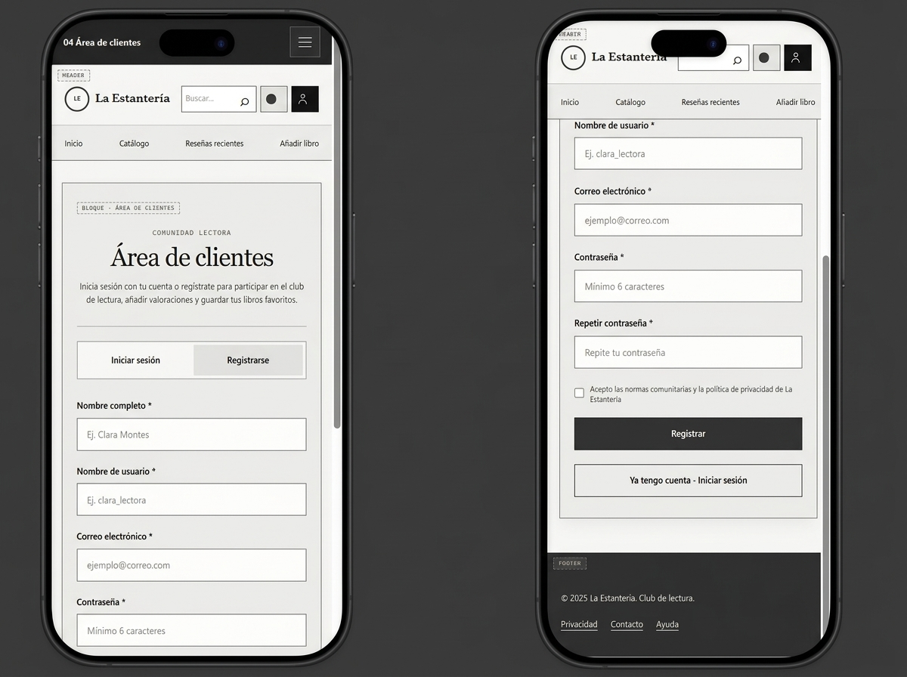

# Diseño de La Estantería

## 1. Público objetivo y justificación

**Público:** lectores habituales, estudiantes y miembros de clubes de lectura que quieren organizar sus lecturas, descubrir títulos y compartir opiniones sin el ruido ni la publicidad de las redes sociales masivas.

**Decisiones de comunicación visual:**

- **Estética editorial y cálida.** El crema, el marrón tinta y el terracota evocan el papel y una estantería en casa. Transmiten calma y cercanía, lo contrario de una interfaz fría y recargada.
- **Las portadas son las protagonistas.** El catálogo es una cuadrícula de portadas y la interfaz se mantiene discreta para no competir con ellas.
- **Tipografía con serifa en los títulos.** Da carácter literario y separa los títulos de las obras del resto de la interfaz, que usa una sans-serif neutra y legible.
- **Modo claro y modo oscuro.** El claro (papel crema) sirve para la lectura diurna. El oscuro (marrón tostado suave) sirve para consultar el club por la noche sin cansar la vista. La preferencia se guarda y se recuerda en las siguientes visitas.
- **Navegación simple.** Tres pantallas principales (catálogo, detalle y formulario), una jerarquía clara y un navbar fijo, para que cualquier usuario se oriente sin aprendizaje previo.
- **Diseño adaptable.** La interfaz funciona en móvil y en escritorio.

## 2. Paleta de colores

Los valores coinciden con las variables CSS de `styles.css`.

### Modo claro (papel y tinta)

| Uso | Variable CSS | HEX |
|---|---|---|
| Fondo | `fondo` |  `#FAF8F2` |
| Tarjetas y secciones | `tarjeta` |  `#F5F0E6` |
| Texto principal | `texto` |  `#5A4E47` |
| Texto secundario | `texto-sec` |  `#8A7F76` |
| Acento (botones, enlaces) | `acento` |  `#B57F65` |
| Acento al pasar el ratón | `acento-hover` |  `#9C6850` |
| Campos de formulario | `campo` |  `#FFFFFF` |
| Texto sobre el acento | `sobre-acento` |  `#FFFFFF` |
| Bordes | `borde` | `rgba(90, 78, 71, 0.18)` |

### Modo oscuro (marrón tostado)

Se activa con `data-tema="oscuro"` en `<html>`.

| Uso | Variable CSS | HEX |
|---|---|---|
| Fondo | `fondo` |  `#2A2420` |
| Tarjetas y secciones | `tarjeta` |  `#352E29` |
| Texto principal | `texto` |  `#F5F0E6` |
| Texto secundario | `texto-sec` |  `#B8AEA4` |
| Acento (botones, enlaces) | `acento` |  `#C98F74` |
| Acento al pasar el ratón | `acento-hover` |  `#D9A28A` |
| Campos de formulario | `campo` |  `#241F1B` |
| Texto sobre el acento | `sobre-acento` |  `#2A2420` |
| Bordes | `borde` | `rgba(245, 240, 230, 0.16)` |

### Contraste (WCAG 2.1, mínimo AA 4,5:1 en texto normal)

| Combinación | Claro | Oscuro |
|---|---|---|
| Texto principal / fondo | 7,56  | 13,48  |
| Texto principal / tarjeta | 7,07  | 11,75  |
| Texto secundario / fondo | 3,68  | 7,02  |
| Texto secundario / tarjeta | 3,44  | 6,12  |
| Texto sobre botón de acento | 3,39  | 5,59  |

**Puntos a mejorar en el modo claro:** el texto secundario y el texto blanco sobre el botón de acento no llegan a 4,5:1. Ajustes propuestos, ya comprobados:

- `texto-sec`:  `#8A7F76` →  `#6F645C` (5,06 sobre la tarjeta).
- `acento`:  `#B57F65` →  `#9A6248` (4,98 con texto blanco).

## 3. Tipografías

| Uso | Fuente | Alternativas (fallback) |
|---|---|---|
| Títulos y nombre de la app (`fuente-titulo`) | **Georgia** (serifa) | "Times New Roman", serif |
| Cuerpo, navegación y formularios (`fuente-texto`) | **Inter** (sans-serif) | ui-sans-serif, system-ui, "Segoe UI", sans-serif |

- Georgia es una fuente del sistema, por lo que no requiere descarga.
- Inter se declara como primera opción; si no está instalada, se usa la fuente del sistema. Está bajo licencia SIL Open Font License 1.1.
- Escala orientativa: títulos de página entre 28 y 62 px (`clamp`), cabecera de sección 22 px, cuerpo 15–17 px, texto pequeño 13 px.
- Interlineado del cuerpo: 1,5.

## 4. Wireframes

Tres vistas principales, en versión escritorio (1440 px) y móvil (390 px).

### Catálogo 

Header con logo y buscador, navbar fijo, cuadrícula de libros agrupada por géneros (Romance; Misterio y crimen; Ciencia ficción y fantasía; Religión y desarrollo personal), reseñas destacadas y footer.

| Escritorio | Móvil |
|---|---|
|  |  |

### Detalle del libro y reseñas 

Portada, datos y valoración, resumen y listado de reseñas.

| Escritorio | Móvil |
|---|---|
|  |  |

### Formulario de alta y edición 

Campos obligatorios (título, autor, género, año, sinopsis, estado de lectura y portada) y reseña opcional.

| Escritorio | Móvil |
|---|---|
|  |  |

### Log In 

Campos obligatorios para poder iniciar sesión/registrarse dependiendo del estado en el que se encuentre el usuario.  

| Escritorio | Móvil |
|---|---|
|  |  |

| Escritorio | Móvil |
|---|---|
|  |  |

## 5. Atribuciones

- Fuentes: Inter (SIL OFL 1.1) y Georgia (fuente del sistema).
- Wireframes: elaborados por el equipo con Figma a partir de bocetos a mano.